<p align="center">
  
</p>

```console
$ cat briefing.txt
Third-year CS student in Paris (Université Paris Cité), after three years at ESI Algiers.
I like knowing how things work underneath: databases, operating systems, networks, cryptography.
I play CTFs to break things on purpose, then learn how to fix them.
```

## 🏁 Scoreboard

Every project is a solved challenge.

| Status | Challenge | Category | Brief |
|:--:|---|:--:|---|
| ✅ | **ShopDB** | `db` | 12-table e-commerce database with recursive structures (MySQL) |
| ✅ | **DiskManager** | `systems` | Disk space manager for a DBMS: pages, allocation, tests (Java) |
| ✅ | **Lumière Jewelry Manager** | `web` | Shop management app that runs from a single file (HTML · JS) |
| ✅ | **PC Diagnostic Sheet** | `web` | Battery, disk and functional test report with PDF export (HTML · JS) |
| ✅ | **Explorer les merveilles de l'Algérie** | `game` | Educational geography exploration game, team project |
| ✅ | **Qobtan's Adventure** | `game` | Game built in a team of six |
| ⏳ | **Next one** | `???` | Loading… |

<!-- Turn names into links once the repos are public: [**ShopDB**](https://github.com/YOUR_USERNAME/shopdb) -->

## 🧰 Loadout


**Speaks:** Arabic · Kabyle · French · English

## 🚩 Bonus challenge

There is a flag on this profile. Two layers, no tools needed beyond a terminal.

```text
526b7842523374334d32786a4d47316c5833517758323030626a466b4e563977636a426d4d57786c66513d3d
```

<details>
<summary>Hint</summary>

It was encoded twice. The second layer ends with `==`.

</details>

Solved it? Send me the flag: [manidaouali1@gmail.com](mailto:manidaouali1@gmail.com)
