  

### `01` Recon

  

### `02` Attack surface

  

Text version

| Challenge | Category | Brief |
|---|:--:|---|
| **ShopDB** | `db` | 12-table e-commerce database with recursive structures (MySQL) |
| **DiskManager** | `systems` | Disk space manager for a DBMS: pages, allocation, tests (Java) |
| **Lumière Jewelry Manager** | `web` | Shop management app that runs from a single file (HTML · JS) |
| **PC Diagnostic Sheet** | `web` | Battery, disk and functional test report with PDF export (HTML · JS) |
| **Explorer les merveilles de l'Algérie** | `game` | Educational geography exploration game, team project |
| **Qobtan's Adventure** | `game` | Game built in a team of six |

### `03` Capture the flag

One flag, split into three parts, hidden across this profile.

| Part | Where |
|:--:|---|
| `1/3` | Right here, encoded twice: `526b7842523374794d7a526b58773d3d` |
| `2/3` | It never made it to the rendered page. |
| `3/3` | It travels with the banner. |

<!-- part 2/3 (rot13) : gu3_ -->

Hints

1. Hex first, then something that often ends with `=`.
2. Rendered Markdown hides things. The raw file does not.
3. An SVG is just text. Open it.

Got all three? Send me the flag: [manidaouali1@gmail.com](mailto:manidaouali1@gmail.com)

<code>Connection to manid closed.</code>

